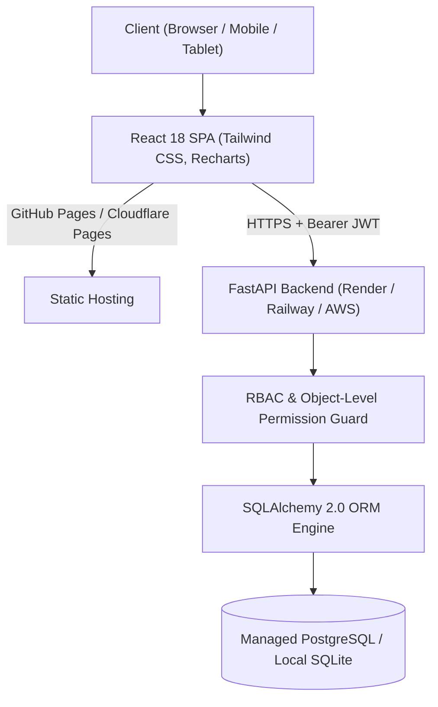

# College Student Management System (CSMS)
## Institutional Academic & Administrative ERP for Engineering Colleges


A centralized, responsive, role-based Student Management System built for engineering colleges offering:
1. **Undergraduate (UG)**: 4-Year B.Tech programs (Year 1 to Year 4, Semesters 1 to 8).
2. **Postgraduate (PG)**: 2-Year M.Tech programs (Semesters 1 to 4).
3. **Ph.D. Research**: Configurable doctoral candidate tracking.

---

## 🏛️ System Architecture



---

## 👥 Role-Based Access Control (RBAC) Matrix

| Role | Scope | Key Capabilities |
| :--- | :--- | :--- |
| **Dean** | Institution-Wide | Comprehensive student strength analytics, department metrics, audit logs |
| **Department HOD** | Assigned Department | Department faculty, subject allocation, marks approval, attendance review |
| **Professor / Faculty** | Assigned Courses | Enter internal assessment marks, record class attendance, student performance |
| **Subject Faculty** | Assigned Sections | Section-wise attendance marking, evaluation, marks submission |
| **Guest Lecturer** | Restricted Sessions | Time-limited read-only access to assigned lecture sessions and course materials |
| **Student** | Personal Record | Subject-wise attendance %, published marks, timetable, contact diary |
| **Admin Staff** | Institutional Registry | Student enrollment, department & program registry, academic years & batches |
| **Parent / Guardian** | Linked Ward Only | View ward's attendance percentage, published results, college announcements |

---

## 🚀 Quick Start Guide

### 1. Prerequisites
- **Python**: Version 3.10+ (Tested on Python 3.14)
- **Node.js**: Version 18+ (Tested on Node.js 22)
- **Git**

---

### 2. Backend Setup (FastAPI + SQLAlchemy)

```bash
# Navigate to the backend directory
cd backend

# Create and activate a Python virtual environment
python -m venv venv
# On Windows:
venv\Scripts\activate
# On Linux/macOS:
source venv/bin/activate

# Install dependencies
pip install -r requirements.txt

# Populate database schema and fictional institutional seed data
python seed_data.py

# Run the automated backend verification suite
python test_api.py

# Launch the FastAPI ASGI server
uvicorn app.main:app --reload --port 8000
```

Once running:
- **Interactive Swagger API Docs**: [http://localhost:8000/docs](http://localhost:8000/docs)
- **ReDoc API Documentation**: [http://localhost:8000/redoc](http://localhost:8000/redoc)
- **Health Check**: [http://localhost:8000/health](http://localhost:8000/health)

---

### 3. Frontend Setup (React.js + Tailwind CSS)

```bash
# Navigate to the frontend directory
cd frontend

# Install Node dependencies
npm install

# Start the Vite development server
npm run dev
```

The portal will open at `http://localhost:5173`.

---

## 🔑 Demo Institutional Accounts (One-Click Testing)

All accounts are pre-configured with realistic fictional engineering college data:

| Role | Username / Identifier | Password | Primary Scope |
| :--- | :--- | :--- | :--- |
| **Dean** | `dean@engineering.edu` | `Dean@123` | Institution analytics & audit trail |
| **Department HOD** | `hod.cse@engineering.edu` | `Hod@123` | CSE Department operations |
| **Professor** | `prof.sharma@engineering.edu` | `Faculty@123` | Operating Systems (CS303) |
| **Subject Faculty** | `faculty.anita@engineering.edu` | `Faculty@123` | Data Structures (CS301) |
| **Guest Lecturer** | `guest.lecturer@engineering.edu` | `Guest@123` | Assigned lecture sessions |
| **Student (UG Year 2)**| `2024CS101` | `Student@123` | Arun Kumar (B.Tech CSE Sem 3) |
| **Student (UG Year 3)**| `2023CS205` | `Student@123` | Priya Raman (B.Tech CSE Sem 5) |
| **Admin Staff** | `admin@engineering.edu` | `Admin@123` | Institutional registry & batches |
| **Parent** | `parent.ramesh@gmail.com` | `Parent@123` | Ward Arun Kumar (2024CS101) |

---

## 🛡️ Cybersecurity & Privacy Safeguards

1. **Object-Level Authorization**: Roll numbers and IDs are validated against the authenticated session token. Cross-student profile lookups return strict `403 Forbidden`.
2. **Contact Privacy Safeguard**: Parent phone numbers, home addresses, and emergency contacts are strictly private. The public directory only exposes entries where students gave explicit affirmative consent (`is_public_in_directory: true`).
3. **Audit Trail**: Every student lookup, grade alteration, and contact diary access triggers an immutable record in `audit_logs`.
4. **Attendance Rule**: Low attendance is automatically flagged when attendance drops below the 75% statutory requirement:
   $$\text{Attendance Percentage} = \left(\frac{\text{Classes Attended}}{\text{Conducted Classes}}\right) \times 100$$
